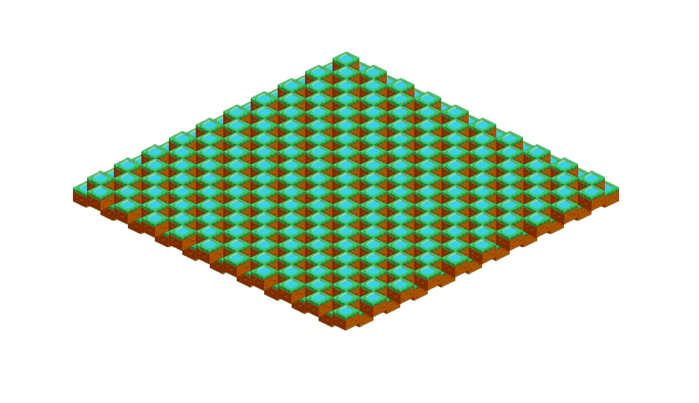

# Timeless Engine

A game engine written in C++ built around an **Entity Component System (ECS)** architecture with a unique time-sequencing system. Supports desktop (Windows, macOS, Linux), iOS and **WebAssembly** builds.



> ⚠️ This engine is a work in progress. Breaking changes may occur.

---

## Features

- **ECS architecture** — entities, components, and systems are cleanly separated
- **Time-sequencing (Behaviour system)** — schedule ordered sequences of actions for entities across fixed time ticks, with built-in support for going forwards *and* backwards in time
- **Isometric grid** — a built-in graph data structure for 2D tile grids with automatic neighbour calculation
- **Rendering** — OpenGL-based sprite, text, and particle rendering with support for multiple layered render passes and a full-screen shader pipeline
- **Camera system** — orthographic and perspective cameras; supports multiple cameras per scene (e.g., separate game and UI cameras)
- **Animation system** — keyframe-based animations with positional interpolation
- **Input handling** — keyboard, mouse and touch input behind the engine's own key and button types (SDL2 underneath, never in your code), including hover and click detection in both orthographic and perspective modes
- **Sound** — FMOD-based sound system
- **Movement system** — camera panning (keys, drag) and zooming (scroll, pinch), eased
- **Scenes** — a scene lifecycle and deferred scene transitions
- **WebAssembly support** — build and run in the browser via Emscripten

---

## Architecture

### Core concepts

| Concept | Description |
|---|---|
| `Entity` | A simple integer ID representing a game object |
| `Component` | Plain data structs attached to entities (e.g., `Transform`, `Sprite`, `Behaviour`) |
| `System` | Logic that processes entities with specific components (e.g., `RenderingSystem`, `NpcAiSystem`) |
| `ComponentManager` | Stores and retrieves all components |
| `WindowManager` | Manages the window, input events, and OpenGL framebuffers |

Everything is reached through the `TE::` namespace: `TE::init()`, `TE::create_system<T>(name, system)` / `TE::get_system<T>(name)`, `TE::add_component<T>(entity, component)` / `TE::get_component<T>(entity)`, `TE::cleanup()`.

### Modules and headers

The engine builds as three static libraries, so a game links only what it uses:

| Target | Contents |
|---|---|
| `timeless` | The core: components, rendering, input, window, grid |
| `timeless-audio` | `SoundSystem` — the only target that links FMOD |
| `timeless-ai` | `NpcAiSystem` — time-sequencing |

`#include "timeless/timeless.hpp"` pulls in the whole engine. To include less, take `timeless/core.hpp` (the `TE::` facade) plus the component and system headers you use; every header compiles on its own.

### Windowing and input

Windows, input and timing run on SDL2, but SDL stays inside the engine: game code uses `TE::Key`, `TE::MouseButton` and `TE::now_seconds()` (`timeless/input.hpp`), and asks the `WindowManager`:

```cpp
auto wm = TE::get_window_manager();
if (wm->is_key_pressed(TE::Key::Space)) { /* ... */ }
if (wm->is_mouse_button_pressed(TE::MouseButton::Left)) { /* ... */ }
glm::vec2 cursor = wm->get_cursor_position();
```

For events instead of polling, give an entity a `KeyboardInputListener` (and register it with a `KeyboardInputSystem`) or a `MouseInputListener<MouseEvent>`; `TE::clicked_on(event, entity)` tells whether a mouse event is on an entity.

### Time-sequencing

The `NpcAiSystem` drives the time-sequencing model. Each entity can have a `Behaviour` component, which holds a list of `Instruction`s (lambda functions), one per tick. The system advances through these instructions tick-by-tick at a user-defined interval (`change_timer(seconds)`), once it's started with `play_forward()`. Because instructions can also be traversed in reverse (`play_backward()`, which runs them with `reverse` set), this naturally supports **undo** or **rewind** mechanics.

```cpp
std::vector<Instruction> instructions;
for (int i = 0; i < TESettings::MAX_TICKS; i++) {
    instructions.push_back(Instruction([](Entity entity, bool reverse, float speed) {
        // do something each tick, or undo it when reverse is set
    }));
}
TE::add_component<Behaviour>(my_entity, new Behaviour(instructions));
TE::get_system<NpcAiSystem>("NpcAiSystem")->register_entity(my_entity);
```

### Isometric grid

Nodes placed on the grid are connected to their neighbours automatically after calling `TE::calculate_grid()`. Use `graph.hpp` to traverse or query the grid.

```cpp
TE::add_component<Node>(tile, new Node(x, y, layer, tile_w, tile_h, x, 0));
// ... add all tiles ...
TE::calculate_grid(); // calculates all neighbour connections
```

---

## Dependencies

The following libraries are required. They are all under `vendor/`, some as git submodules.

| Library | Purpose |
|---|---|
| [SDL2](https://www.libsdl.org/) | Window creation, input and timing |
| [GLAD](https://glad.dav1d.de/) | OpenGL function loader |
| [GLM](https://github.com/g-truc/glm) | Math (vectors, matrices) |
| [FreeType](https://freetype.org/) | Font rendering |
| [FMOD](https://www.fmod.com/) | Audio playback |
| [Assimp](https://github.com/assimp/assimp) | 3D model importing |
| [stb_image](https://github.com/nothings/stb) | Image loading |

> **FMOD** is a proprietary library. You must download it separately from [fmod.com](https://www.fmod.com/download) and place it in `vendor/fmod/`.

---

## Building

### Prerequisites

- CMake ≥ 3.19
- A C++20-compatible compiler (GCC, Clang, MSVC)
- All submodules initialized: `git submodule update --init --recursive`
- FMOD SDK placed in `vendor/fmod/` (see above)

### Desktop (Linux / macOS / Windows)

```bash
cmake -B build
cmake --build build
```

This builds the engine libraries, the [example](#example) and `timelessResourcePacker`. The FMOD libraries are copied to the build output directory (Windows, Linux).

To use the engine in a game, add it as a subdirectory and link the modules you need:

```cmake
add_subdirectory(timeless)
target_link_libraries(MyGame PUBLIC timeless timeless-audio timeless-ai)
```

### WebAssembly (Emscripten)

A WebAssembly build is made from the game that uses the engine: pass `-DEMSCRIPTEN=ON` (and `-DEMSCRIPTEN_PTHREADS=ON` for a threaded build) to its configure.

```bash
emcmake cmake -B build-wasm -DEMSCRIPTEN=ON
emmake cmake --build build-wasm
```

The game's `Assets/` directory is embedded in the build. [`web/`](web/README.md) has scripts that build, package and serve a game for the web, and the HTML shell it runs in.

---

## Quick Start

A sprite that steps to the right every tick. It expects the engine's `shaders/` copied to `Assets/shaders/`, and a spritesheet (this one is the example's).

```cpp
#include "timeless/timeless.hpp"

// the engine leaves stb_image's implementation to the game
#define STB_IMAGE_IMPLEMENTATION
#include "stb_image.h"

int main() {
    TE::init(); // opens the window and creates the OpenGL context

    // Resources. The engine's shaders are in shaders/; copy them next to your game.
    auto screen_shader = std::make_shared<Shader>("Assets/shaders/webgl_screen.vs", "Assets/shaders/webgl_screen.fs");
    auto sprite_shader = std::make_shared<Shader>("Assets/shaders/webgl_sprite.vs", "Assets/shaders/webgl_sprite_slice.fs");
    auto quad = std::make_shared<Quad>();
    auto texture = std::make_shared<Texture>("Assets/textures/example_tiles.png", 512, 672);

    // The scene is drawn into a framebuffer, and that to the screen through a shader
    TE::get_window_manager()->add_framebuffer(screen_shader);

    // Create systems
    TE::create_system<RenderingSystem>("Renderer", new RenderingSystem());
    TE::create_system<NpcAiSystem>("AI", new NpcAiSystem());
    auto renderer = TE::get_system<RenderingSystem>("Renderer");
    auto ai = TE::get_system<NpcAiSystem>("AI");

    // Create a camera: a flat 2D view, looking down the z axis with y running down
    Entity cam = create_entity();
    TE::add_component<Camera>(cam, new Camera(glm::vec3(0.0f, 0.0f, 1000.0f), false,
                                              glm::vec3(0, 0, -1), glm::vec3(0, -1, 0)));
    TE::get_component<Camera>(cam)->set_rotation(glm::quat(1.0f, 0.0f, 0.0f, 0.0f));
    renderer->register_camera(cam);

    // Create an entity with a sprite and a timed behaviour: it steps right every tick,
    // and back again when time runs backward
    Entity e = create_entity();
    TE::add_component<Quad>(e, quad);
    TE::add_component<Texture>(e, texture);
    TE::add_component<Shader>(e, sprite_shader);
    TE::add_component<Transform>(e, new Transform(glm::vec3(0, 0, 0), 0.f, 32.f, 32.f));
    TE::add_component<Sprite>(e, new Sprite(66, glm::vec4(1.0f), glm::vec2(512, 672), glm::vec2(32, 32)));
    std::vector<Instruction> instructions;
    for (int i = 0; i < TESettings::MAX_TICKS; i++) {
        instructions.push_back(Instruction([](Entity ent, bool reverse, float speed) {
            TE::get_component<Transform>(ent)->translate(glm::vec3(reverse ? -8.f : 8.f, 0.f, 0.f));
        }));
    }
    TE::add_component<Behaviour>(e, new Behaviour(instructions));
    renderer->register_entity(e);
    ai->register_entity(e);

    ai->change_timer(0.25f);                       // seconds per tick
    ai->play_forward(*TE::get_component_manager()); // or play_backward()

    auto wm = TE::get_window_manager();
    while (!wm->should_close()) {
        TE::loop([&](WindowManager& wm, ComponentManager& cm) {
            ai->update(cm);

            wm.select_framebuffer(0);
            renderer->render(cm, TESettings::VIEWPORT_X, TESettings::VIEWPORT_Y, TESettings::ZOOM, ai->main_index);
            glBindFramebuffer(GL_FRAMEBUFFER, TE::screen_framebuffer);
            wm.render_framebuffer_as_quad(0, true, ai->main_index, true);

            wm.swap_buffers();
            wm.poll_events();
        });
    }

    // release GL resources before the engine closes the window
    screen_shader.reset(); sprite_shader.reset(); quad.reset(); texture.reset();
    TE::cleanup();
    return 0;
}
```

Paths are relative to the working directory, so run it from where `Assets/` is.

---

## Example

The `example/` directory contains a complete program that:

- Sets up a 20×20 isometric tile grid from a spritesheet
- Sequences per-tile behaviours with the `NpcAiSystem`: the tiles ripple as time ticks forward, and ripple back when it's rewound (with a full-screen rewind shader)
- Uses two cameras (game world + UI) and two render layers
- Handles keyboard and mouse input through the engine

It is built alongside the engine. Run it from its own directory, where the build puts its `Assets/`:

```bash
cmake -B build && cmake --build build
cd build/example && ./example
```

| Input | Action |
|---|---|
| `W` `A` `S` `D` / arrow keys, or drag | Move the camera |
| Scroll wheel | Zoom |
| `Space` | Pause / resume |
| `Enter` | Change the direction of time |
| `Escape` | Quit |

---

## Should I use this?

Timeless is an early-stage engine tailored for games that need **time-sequenced, grid-based mechanics**. If you are interested in the time-rewinding / sequencer concept, want to build isometric grid games, or want to contribute — you're welcome!

For general-purpose 2D game development, a more mature engine may be a better fit today.

---

## Contributing

Contributions, bug reports, and feature requests are welcome. Feel free to open an issue or a pull request.

---

## License

This project does not currently have an explicit license. Please contact the author before using it in your own projects.


